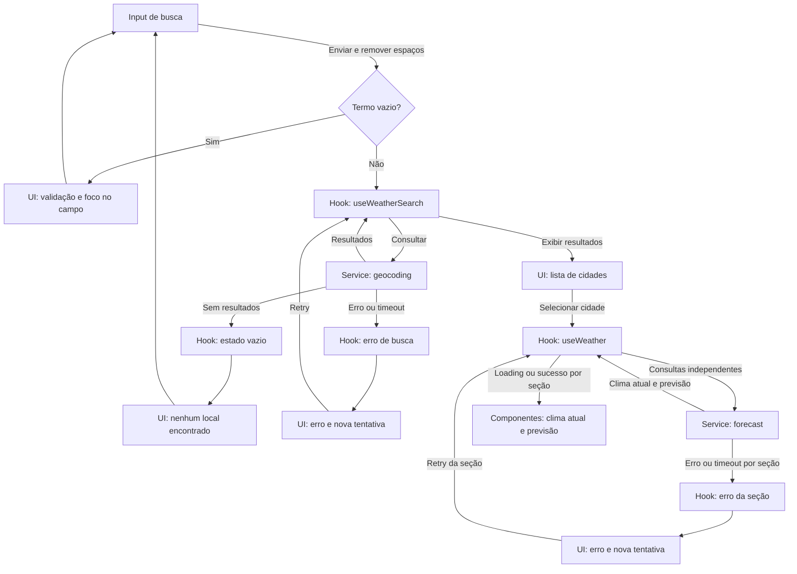

# Plano Técnico — Weather App

Este plano deriva de [weather-app-spec.md](../specs/weather-app-spec.md), que é a fonte da verdade para escopo e comportamento. Requisitos e critérios são referenciados pelos IDs da especificação; qualquer mudança em decisões fechadas deve começar por uma revisão da spec.

## Architecture

Aplicação client-side com dependências em uma direção: a apresentação dispara intenções, hooks orquestram estado e chamadas, services lidam com I/O e `lib` contém lógica pura. Tipos compartilhados descrevem os contratos entre essas camadas.

```text
components (renderização e eventos de UI)
  ↓ intenções do usuário
hooks (estado, concorrência, loading/erro/retry)
  ↓ chamadas tipadas                 ↓ funções puras
services (HTTP, parsing)             lib (conversão, datas, códigos WMO)
  ↓ HTTPS + JSON
Open-Meteo
```

- **`components/` (apresentação):** recebe dados, estados e callbacks por props; renderiza busca, resultados, clima atual, previsão e unidade. Não chama APIs nem contém regras de conversão, facilitando testes de renderização, acessibilidade e interação com Testing Library.
- **`hooks/` (orquestração/estado):** coordena busca e seleção, controla operações assíncronas independentes para clima atual e previsão, descarta respostas obsoletas e oferece retry. Testes exercitam transições de estado e concorrência com services simulados.
- **`services/` (acesso a dados):** encapsula `fetch`, URLs, timeout, tratamento de status e validação/normalização do JSON Open-Meteo. Testes unitários podem usar respostas HTTP simuladas para cobrir mapeamento e falhas sem renderizar componentes.
- **`lib/` (funções puras):** contém conversão/arredondamento, formatação de datas por fuso e mapeamento de códigos WMO. Entrada e saída determinísticas permitem testes unitários sem rede, React ou mocks (RNF9).
- **`types/` (contratos):** define modelos normalizados compartilhados. As camadas dependem desses contratos em vez de importar formatos de resposta específicos da API.
- `App.tsx` compõe componentes e hooks, sem assumir a implementação HTTP ou concentrar a lógica de transformação.
- Não haverá backend, autenticação, cache persistente ou armazenamento de buscas/localizações. A aplicação informa que o termo é enviado ao geocoding e usa apenas HTTPS (RNF6, A5).

## Tech Stack

| Tecnologia | Uso e justificativa |
| --- | --- |
| TypeScript strict | Contratos explícitos para respostas externas e estados; reduz erros de campos opcionais. |
| React 19 + React DOM | UI por componentes e estado local, já adotados pelo repositório. |
| Vite | Servidor de desenvolvimento e build da aplicação existente. |
| Tailwind CSS | Estilização responsiva, já presente no projeto; validar os breakpoints requeridos em vez de depender de um único layout. |
| Vitest + Testing Library + user-event | Testes unitários e de interação acessível, já configurados como dependências. |
| Playwright | Fluxos E2E e viewports/navegadores exigidos pela spec; presente no projeto. |
| Biome | Lint e formatação conforme configuração e scripts existentes. |
| Open-Meteo | Geocoding e dados meteorológicos sem API key, conforme A6; uso público depende da validação de termos, limites, atribuição e cobertura. |

## Project Structure

Estrutura proposta, compatível com as convenções do projeto e com as fronteiras acima:

```text
src/
  App.tsx                    composição da tela e ligação entre hooks e componentes
  components/
    CitySearch.tsx           campo, envio, validação e resultados
    CurrentWeather.tsx       apresentação das condições atuais
    Forecast.tsx             apresentação dos dias e previsão incompleta
    TemperatureUnitToggle.tsx controle acessível da unidade selecionada
  hooks/
    useWeatherSearch.ts      estado da busca, submissão e seleção
    useWeather.ts            estado independente de atual/previsão e retry
  services/
    openMeteo.ts             requisições, timeout e normalização de respostas
  types/
    weather.ts               modelos normalizados e estados assíncronos
  lib/
    temperature.ts           conversão e arredondamento
    date.ts                  formatação de datas/horários por fuso local
    weatherCode.ts           descrição e ícone a partir do código WMO
tests/
  unit/                      lógica pura, mapeamento HTTP e hooks
  components/                renderização, acessibilidade e interações
  e2e/                       fluxos completos e responsividade
```

Manter os arquivos de teste alinhados à configuração existente do Vitest e Playwright. Os testes unitários isolam cada fronteira; testes de componentes verificam comportamento visível e acessível; E2E confirma que a composição real atende aos fluxos e viewports da spec. A estrutura é uma proposta inicial, sem abstrações adicionais nem persistência.

## Data Model

Contratos internos conceituais; os valores meteorológicos são mantidos em Celsius na memória. Campos que a fonte pode omitir são opcionais/nulos e exibidos como “Indisponível”, sem conversão (seção 2.1, EC14).

```ts
type Unit = 'celsius' | 'fahrenheit';

interface City {
  id: number; // Identificador do local no geocoding Open-Meteo.
  name: string; // Nome do local retornado pela busca.
  region?: string; // Região ou estado, quando fornecido (admin1).
  country?: string; // País, quando fornecido.
  latitude: number; // Latitude válida usada na consulta meteorológica.
  longitude: number; // Longitude válida usada na consulta meteorológica.
  timezone?: string; // Fuso IANA do local, quando fornecido.
}

interface CurrentWeather {
  temperatureC: number | null; // Temperatura atual em Celsius.
  feelsLikeC: number | null; // Sensação térmica em Celsius.
  humidityPercent: number | null; // Umidade relativa em porcentagem.
  windSpeedKmh: number | null; // Velocidade do vento em km/h.
  observedAt: string | null; // Horário ISO retornado pela API no fuso local.
  conditionCode: number | null; // Código WMO usado para obter texto e ícone.
}

interface ForecastDay {
  localDate: string; // Data local no formato ISO (AAAA-MM-DD).
  conditionCode: number | null; // Código WMO da condição do dia.
  minimumC: number | null; // Temperatura mínima em Celsius.
  maximumC: number | null; // Temperatura máxima em Celsius.
  precipitationProbabilityPercent: number | null; // Probabilidade máxima diária de precipitação.
}

interface Forecast {
  days: ForecastDay[]; // Dias retornados, em ordem cronológica.
  isIncomplete: boolean; // Indica que a fonte retornou menos de cinco dias.
}

interface WeatherData {
  city: City; // Local selecionado para estas consultas.
  current: CurrentWeather | null; // Clima atual, independentemente da previsão.
  forecast: Forecast | null; // Previsão diária, independentemente do clima atual.
}

type WeatherErrorKind = 'network' | 'api' | 'timeout' | 'invalid-response' | 'invalid-location';

interface WeatherError {
  kind: WeatherErrorKind;
  message: string;
  retryable: boolean;
}

type AsyncState<T> =
  | { status: 'idle' }
  | { status: 'loading' }
  | { status: 'success'; data: T }
  | { status: 'empty'; message: string }
  | { status: 'error'; error: WeatherError };
```

`City.id` deve ser determinístico dentro dos resultados e distinguir homônimos; quando o rótulo visível (nome, região e país disponíveis) coincidir, acrescentar coordenadas ao rótulo de apresentação (RF1). A ausência de coordenadas válidas impede a consulta. O fuso horário não é inferido do dispositivo; se ausente, horários locais são indisponíveis (seção 2.1, EC20–EC21).

## Data Flow



1. O usuário edita o campo sem disparar rede; ao enviar, remover espaços das extremidades. Termo vazio mantém o foco no campo, mostra validação e não chama o serviço (RF1, CA-RF1-4, CA-RF1-6, EC2).
2. O serviço de geocoding recebe o termo como texto e retorna cidades com coordenadas válidas. A UI mostra nome, região/estado e país quando disponíveis; seleção é operável por teclado e toque. Lista vazia oferece nova busca (RF1, EC1–EC7).
3. Ao selecionar uma cidade, iniciar carregamentos independentes de clima atual e previsão. A seleção mais recente prevalece; abortar requisições anteriores quando possível e, em qualquer caso, ignorar respostas fora de ordem. Nunca associar dados da cidade anterior ao cabeçalho novo (EC8–EC9).
4. Normalizar respostas para `CurrentWeather` e `Forecast`, mantendo temperaturas em Celsius e datas como datas locais do local selecionado. Converter códigos WMO para descrições e identificadores de ícone sem inventar campos ausentes.
5. Renderizar em ordem cronológica os dias recebidos. A previsão cobre hoje + quatro dias locais quando disponível; menos de cinco dias define `isIncomplete`, sem completar ou duplicar datas (RF3, CA-RF3-1–5).
6. Alternar a unidade apenas altera a apresentação dos dados já carregados, sem requisição. Converter temperatura e sensação térmica pela fórmula da spec; arredondar ao inteiro mais próximo com empates afastando de zero (RF4). Iniciar sempre em Celsius, inclusive após reload (CA-RF4-7, EC16).

## External APIs

Todas as chamadas são HTTPS e usam `fetch` nativo, sem chave. Os exemplos abaixo são esquemáticos: a resposta real pode omitir campos ou retornar `null`; validar os dados e manter esses casos indisponíveis, conforme a seção 2.1 e EC12–EC14.

### Geocoding

```text
GET https://geocoding-api.open-meteo.com/v1/search?name={termo_codificado}&count=10&language=pt&format=json
```

- `name`: termo após trim, codificado como componente de URL; enviar somente após ação explícita do usuário.
- `count`: limite da lista de resultados (10).
- `language`: idioma preferido para nomes retornados (`pt`).
- `format`: formato JSON.

Exemplo resumido:

```json
{
  "results": [
    {
      "id": 3448439,
      "name": "São Paulo",
      "latitude": -23.5475,
      "longitude": -46.6361,
      "timezone": "America/Sao_Paulo",
      "country": "Brazil",
      "admin1": "São Paulo"
    }
  ]
}
```

Mapeamento: `results[].id` → `City.id`; `name` → `name`; `admin1` → `region`; `country` → `country`; `latitude`/`longitude` → coordenadas; `timezone` → `City.timezone`. `admin1`, `country` e `timezone` podem faltar. Descartar locais sem latitude/longitude finitas; não inventar metadados. Se dois resultados mantiverem o mesmo rótulo visível, acrescentar coordenadas ao rótulo apresentado (RF1).

### Forecast

O endpoint é o mesmo para dados atuais e diários:

```text
GET https://api.open-meteo.com/v1/forecast?latitude={lat}&longitude={lon}&current=temperature_2m,relative_humidity_2m,apparent_temperature,weather_code,wind_speed_10m&daily=weather_code,temperature_2m_max,temperature_2m_min,precipitation_probability_max&temperature_unit=celsius&wind_speed_unit=kmh&timezone=auto&forecast_days=5
```

- `latitude` e `longitude`: coordenadas do local selecionado.
- `current`: solicita temperatura, umidade relativa, sensação térmica, código WMO e vento atual.
- `daily`: solicita código WMO, máximas, mínimas e probabilidade máxima diária de precipitação.
- `timezone=auto`: solicita o fuso do local a partir das coordenadas; datas e horas devem ser interpretadas nesse fuso, nunca no do dispositivo.
- `temperature_unit=celsius` e `wind_speed_unit=kmh`: fixam as unidades de entrada esperadas pelo modelo.
- `forecast_days=5`: solicita hoje e os quatro dias seguintes no calendário local.

A API permite pedir `current` e `daily` juntos ou separadamente. Para manter falhas e retry independentes conforme RF2, RF3, RNF7 e EC12, usar duas chamadas ao endpoint: uma com `current=...` e outra com `daily=...`, mantendo coordenadas e `timezone=auto` em ambas. O exemplo combinado abaixo ilustra o formato das duas partes quando presentes na resposta:

```json
{
  "timezone": "America/Sao_Paulo",
  "current": {
    "time": "2026-11-11T09:00",
    "temperature_2m": 21.4,
    "relative_humidity_2m": 68,
    "apparent_temperature": 22.1,
    "weather_code": 3,
    "wind_speed_10m": 10.1
  },
  "daily": {
    "time": ["2026-11-11", "2026-11-12"],
    "weather_code": [3, 61],
    "temperature_2m_max": [24.0, 22.5],
    "temperature_2m_min": [17.2, 16.8],
    "precipitation_probability_max": [10, 65]
  }
}
```

Mapeamento para os tipos do modelo:

- `timezone` da resposta → `City.timezone` do local selecionado; se ausente, indicar indisponibilidade de horário local e não usar o fuso do dispositivo.
- `current.temperature_2m` → `CurrentWeather.temperatureC`; `apparent_temperature` → `feelsLikeC`; `relative_humidity_2m` → `humidityPercent`; `wind_speed_10m` → `windSpeedKmh`; `weather_code` → `conditionCode`; `time` → `observedAt`.
- Cada índice de `daily.time` forma um `ForecastDay`: `time` → `localDate`; `weather_code` → `conditionCode`; `temperature_2m_min`/`temperature_2m_max` → `minimumC`/`maximumC`; `precipitation_probability_max` → `precipitationProbabilityPercent`. Manter a ordem cronológica recebida, validando datas e comprimentos dos arrays; não criar valores para dados ausentes.
- Montar `WeatherData` com o `City` selecionado e preencher `current` e `forecast` de forma independente. Uma falha ou ausência de uma seção não invalida a outra. `Forecast.isIncomplete` é verdadeiro quando há menos de cinco dias válidos; exibir somente os dias recebidos.

Confirmar limites de uso, termos, cobertura e exigência de atribuição como gate de lançamento (A6, seção 10).

## State Management

Usar estado React local, sem biblioteca global. O estado vive junto da responsabilidade que o coordena:

- `CitySearch` mantém somente o texto editável do campo. `useWeatherSearch`, usado por `App`, controla o estado da busca, seus resultados e a cidade selecionada.
- `useWeather(city)` controla dois estados `AsyncState` separados: `currentState` e `forecastState`. Ao trocar de cidade, ambos entram em `loading` para o novo local; dados anteriores não podem ser renderizados como atuais sob o novo cabeçalho.
- `App` mantém `unit: Unit`, inicializado como `celsius` a cada carregamento da página e sem persistência (CA-RF4-1, CA-RF4-7, EC16).
- Os estados explícitos são `idle`, `loading`, `success`, `error` e `empty`. `empty` representa busca concluída sem resultados; as consultas meteorológicas sem dados utilizáveis são erro recuperável, não um sucesso vazio. Validação de termo vazio impede a requisição e mantém o foco no campo (RF1, EC2, EC4).

Somente os valores originais em Celsius são armazenados em `CurrentWeather` e `ForecastDay`. A renderização deriva cada temperatura visível a partir do valor original e de `unit`, usando uma função pura de `lib/temperature.ts`: Celsius exibe o valor arredondado; Fahrenheit aplica $F = C \times 9/5 + 32$ e arredonda o resultado ao inteiro mais próximo, com empates exatos afastando de zero. Sensação térmica, mínima e máxima usam a mesma regra. Valores `null` permanecem indisponíveis e nunca são convertidos. Alterar `unit` apenas atualiza a renderização, sem request ou estado duplicado de valores convertidos (RF4, RNF5, RNF9).

Cada request pertence ao termo/cidade que o iniciou. Abortar a request anterior quando possível e descartar toda resposta cujo identificador já não corresponda à operação corrente. Ações de retry repetem apenas a busca, clima atual ou previsão que falhou (EC8–EC12).

## Error Handling

O service converte falhas de transporte e respostas inválidas em `WeatherError`; hooks expõem o erro no estado da operação correspondente e a UI apresenta mensagem em pt-BR e ação apropriada. Não colocar detalhes internos ou payload bruto na mensagem ao usuário.

- **Rede:** falha de conexão, DNS ou `fetch` vira `error` com `kind: 'network'`, retry habilitado e sem reutilizar dados antigos como atuais (RNF4, EC10).
- **API/HTTP:** resposta não-2xx, incluindo 5xx ou erro declarado pela API, vira `kind: 'api'`, com erro e retry apenas naquela operação. A outra seção mantém seu próprio estado e dados válidos (RNF7, EC10, EC12).
- **Timeout:** limitar geocoding e cada consulta meteorológica a 10 s; expiração vira `kind: 'timeout'` e oferece retry (EC11). Cancelamentos por troca de termo/cidade são obsoletos, não erros visíveis.
- **Resposta inválida:** JSON ilegível ou estrutura incompatível vira `kind: 'invalid-response'`; não assumir zero ou forma válida por coerção. Coordenadas ausentes/inválidas impedem forecast e produzem `kind: 'invalid-location'` (EC20).
- **Resposta parcial:** campo meteorológico individual ausente vira `null`, continua sucesso da seção e aparece como “Indisponível”, sem invalidar outros campos (seção 2.1, EC14). Falha ou ausência de uma seção inteira produz erro apenas nessa seção, preservando a outra (EC12). Previsão com menos de cinco dias continua sucesso com `isIncomplete: true`; exibir apenas os dias recebidos, em ordem e sem duplicações (CA-RF3-5, EC13).
- **Fuso ausente:** manter os dados meteorológicos que tiverem sido recebidos, mas indicar indisponibilidade para horário local; nunca usar o fuso do dispositivo como fallback (seção 2.1, EC18, EC21).
- **Busca sem resultados:** definir busca como `empty`, oferecer edição do termo e nova tentativa de busca; não iniciar consultas meteorológicas (EC1, EC4).
- **Entrada não confiável:** tratar o termo como texto literal, codificar os parâmetros de URL e renderizar resultados como texto, sem interpretar HTML (RNF6, EC3).

## Testing Strategy

### Vitest e Testing Library

- **Funções puras:** verificar conversão Celsius/Fahrenheit e arredondamento, incluindo 0 °C, 25 °C, −40 °C e empates negativos/positivos; valores ausentes não são convertidos. Testar datas e horários no fuso IANA do local, inclusive diferente do dispositivo, e mapeamento de códigos WMO conhecidos e desconhecidos (RF4, RNF8, RNF9, EC14, EC17–EC18).
- **Services com mock de `fetch`:** verificar URLs, parâmetros codificados, coordenadas e normalização de respostas completas, parciais e de previsão curta. Simular lista vazia, HTTP não-2xx, falha de rede, JSON inválido, coordenadas inválidas e timeout de 10 s; conferir tipo de erro e possibilidade de retry. Usar timers controlados para timeout e restaurar mocks e timers após cada teste, sem depender da rede (RF1–RF3, RNF4, EC1–EC4, EC10–EC14, EC20).
- **Hooks:** simular services para testar transições e retry independente de busca, atual e previsão. Resolver requisições fora de ordem e verificar que prevalece a busca/cidade mais recente, sem associar dados antigos ao novo local; falha de uma seção não apaga a outra (RNF7, EC8–EC12).
- **Componentes:** com Testing Library e `user-event`, verificar estados aplicáveis de `idle`, loading, erro, vazio e sucesso: vazio para busca sem resultados; ausência de dados meteorológicos utilizáveis é erro. Cobrir envio explícito, trim, validação e foco no campo vazio, homônimos, dados indisponíveis, previsão incompleta, retry e seleção por teclado. Conferir nomes acessíveis e indicação da unidade, conversão de todas as temperaturas sem nova requisição e retorno a Celsius após reload (CA-RF1–CA-RF4, RNF3, RNF7, EC14–EC16).

### Playwright

- **Fluxos E2E:** exercitar a aplicação integrada: buscar e distinguir homônimos, selecionar cidade, verificar clima atual e cinco dias, alternar unidade sem nova requisição e recarregar para voltar a Celsius. Cobrir busca vazia ou sem resultados, erro de rede/API com retry, falha independente de cada seção, previsão parcial e troca rápida de cidade (RF1–RF4, RNF4, RNF7, EC1–EC2, EC8–EC13, EC16).
- **Rede controlada:** interceptar geocoding e forecast com fixtures representativas para resultados reproduzíveis, incluindo atraso e falhas; contar requisições na alternância. Essa cobertura não valida a disponibilidade nem o contrato real da Open-Meteo: verificar integração e cobertura reais separadamente antes do lançamento, respeitando os termos do serviço (A6).
- **Mobile e responsividade:** executar o fluxo principal em 360 px com interação por toque e verificar ausência de rolagem horizontal, legibilidade dos cinco dias e alvos de pelo menos 44 × 44 px. Verificar também 390, 768 e 1280 px; em 1280 px, conferir conteúdo centralizado com largura máxima de 1200 px (CA-RF5-1–4, RNF1).
- **Acessibilidade e compatibilidade:** exercitar teclado, foco visível, nomes acessíveis e associação de erros; complementar com auditoria automatizada e verificação de contraste WCAG 2.2 AA. Validar o fluxo principal nas duas versões estáveis mais recentes de Chrome, Safari, Firefox e Edge em ambientes reais apropriados; os engines e versões fornecidos pelo Playwright isoladamente não comprovam toda essa matriz (RNF3, RNF10).

### Gates complementares

- **Desempenho:** medir 100 execuções com rede 4G simulada (RTT de 100 ms, download de 10 Mbps e upload de 5 Mbps), registrando o intervalo desde o envio até resultados utilizáveis e o p95 exigido de até 2 s. Medir também alternância em até 100 ms e confirmar ausência de requisições; registrar ambiente, condições de rede e amostras (RNF5).
- **Usabilidade e privacidade:** realizar o teste moderado com ao menos três participantes conforme RNF2; verificar tratamento literal de caracteres especiais, ausência de persistência e aviso de envio ao geocoding (RNF6, EC3).
- Executar `pnpm test`, `pnpm test:e2e`, `pnpm lint` e `pnpm build` nas fases de código e testes; registrar separadamente as validações manuais e de lançamento que não forem automatizadas.

## Risks & Trade-offs

| Decisão | Alternativa considerada | Trade-off e resposta |
| --- | --- | --- |
| Open-Meteo diretamente no cliente | Backend intermediário ou outro provedor | Evita infraestrutura e chave, mas depende de cobertura, limites e disponibilidade externos; validar termos e atribuição antes do lançamento e exibir erros recuperáveis (A6, RNF4). |
| Atual e previsão em duas requisições | Uma chamada combinada ao forecast | Aumenta chamadas e custo de rede, mas permite loading, falha e retry independentes; a chamada única reduz tráfego, porém acopla falhas de transporte (RF2, RF3, RNF7, EC12). |
| Estado React local e Celsius como fonte única | Biblioteca global ou armazenar valores em ambas as unidades | Menos dependências e sem divergência entre unidades; requer coordenar estado e concorrência nos hooks. A alternativa global adiciona complexidade sem necessidade atual (RF4, RNF9). |
| Busca explícita e descarte de respostas obsoletas | Autocomplete a cada tecla ou aceitar respostas na ordem de chegada | Reduz requisições e evita dados de outra busca/cidade, mas acrescenta uma ação e controle de concorrência. Autocomplete está fora do escopo (RF1, EC8–EC9). |
| Contexto de homônimos e coordenadas em rótulos duplicados | Etapa adicional de confirmação | Diferencia locais sem interromper o fluxo; coordenadas podem ser menos familiares, mas evitam inventar metadados (RF1, EC6). |
| Preservar datas locais e fuso retornado | Usar fuso do dispositivo como fallback | Exige validação e testes de calendário; evita horário incorreto, embora um fuso ausente torne o horário indisponível (EC18, EC21). |
| Dados parciais explícitos | Preencher valores ausentes, sintetizar dias ou descartar toda a resposta | Preserva dados válidos e evita falsa precisão, mas exige estados e mensagens adicionais (EC12–EC14). |
| Sem cache ou persistência | Cache local e preferência de unidade persistida | Simplifica privacidade e evita dados antigos, ao custo de novas consultas; a unidade volta a Celsius após reload, como exigido (RNF6, EC16). |
| Testes E2E com rede interceptada | Depender da API real em toda execução | Fixtures são rápidas e reproduzíveis, mas não detectam mudanças reais do provedor; complementar com verificação de integração antes do lançamento (A6, RNF4). |
| Aplicação client-side com JavaScript | Renderização no servidor ou suporte sem JavaScript | Menor complexidade operacional, mas exclui dispositivos sem JavaScript; validar a matriz de navegadores exigida e registrar a limitação (RNF10, EC19). |